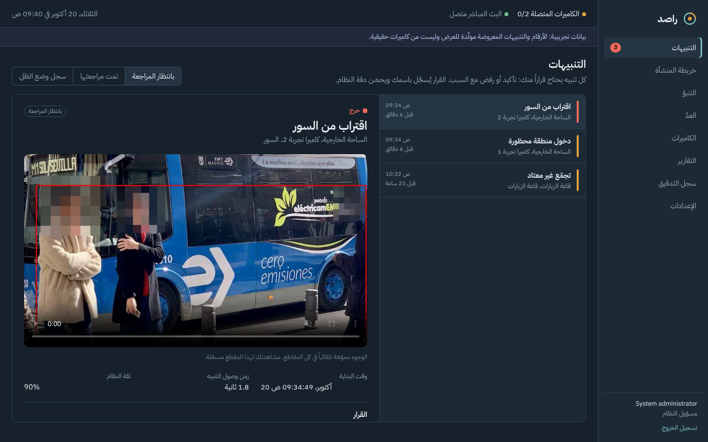

# راصد · Rased

منصة تحليل فيديو ذكي للمنشآت المغلقة. تستقبل بث كاميرات المراقبة الموجودة (RTSP)، وتكشف الحوادث لحظة بدايتها، وتقيس التوتر في كل منطقة وتتنبأ به خلال الـ24 ساعة القادمة. يبقى القرار دائماً بيد المشغّل.

> CCTV video analytics for secure facilities: real-time incident detection, per-area tension index and 24-hour forecasting, with a human in the loop. Arabic-first command centre.



## ما الذي يعمل الآن

| الوحدة | المحتوى | الحالة |
| --- | --- | --- |
| الكشف اللحظي | العراك، والسقوط والخمول الطويل، والتجمعات والركض، والاقتراب من السور والمناطق المحظورة (مع ساعات الحظر)، والأغراض المتروكة، والعبث بالكاميرا وانقطاعها | يعمل، ومغطى بالاختبارات |
| التشغيل والامتثال | العدّ الآلي في أوقات العدّ مع تنبيه عند الفرق، وقياس دقته مقابل العدّ اليدوي | يعمل |
| تحليل السلوك | النمط الطبيعي لكل منطقة حسب ساعة الأسبوع، والانحراف عنه، وكشف الشذوذ (Isolation Forest)، ومؤشر التوتر من 0 إلى 100 مع مكوّناته | يعمل |
| التنبؤ | توقع المؤشر لكل منطقة خلال 24 ساعة (Holt-Winters أو النمط اليومي)، والمناطق الساخنة، وتقرير «ماذا يسبق الحوادث» | يعمل |
| مركز القيادة | التنبيهات مباشرة (SSE) مع المقطع والقرار، وخريطة المنشأة، والتنبؤ، والكاميرات ومحرر المناطق، والعدّ، والتقارير ومؤشرات النجاح، وسجل التدقيق، والإعدادات | يعمل |
| الحوكمة | الصلاحيات حسب الدور، وسجل تدقيق للإضافة فقط، وتمويه الوجوه، ومدد الاحتفاظ والحذف التلقائي، ووضع الظل، والتشغيل المحلي بدون إنترنت | يعمل |
| تحسين النظام بدون مختص | تحويل قرارات المشغّلين إلى بيانات مصنّفة، والتقسيم، والتدريب من الواجهة، والمقارنة بالنموذج الحالي، والتفعيل ببوابة جودة، واقتراحات ضبط القواعد لكل كاميرا | يعمل ([docs/training-studio.md](docs/training-studio.md)) |
| نموذج العراك المدرّب | خط كامل من الواجهة أو من سطر الأوامر: التدريب، والتقييم، والتصدير إلى ONNX، والتفعيل بدون إعادة تشغيل | يعمل، ويحتاج بيانات حقيقية كافية لنموذج يُعتمد عليه |

إلى أن يُدرَّب نموذج العراك، يعمل الكشف بقواعد مبنية على حركة الذراعين وقرب الأشخاص. الواجهة تبيّن الوضع المستخدم لكل كاميرا.

## البنية

```
كاميرات IP ──RTSP──▶ vision (Python · YOLO11 pose + ByteTrack · قواعد · ONNX)
                         │  أحداث + مقاطع + قراءات كل دقيقة + نبض
                         ▼
                      api (NestJS · PostgreSQL)  ◀── analytics (pandas · scikit-learn · statsmodels)
                         │  REST + بث مباشر (SSE)       كل 15 دقيقة: المؤشر والتنبؤ
                         ▼
                      web (React · عربي RTL) يُخدَم من نفس الخادم
```

التفاصيل في [docs/architecture.md](docs/architecture.md).

## نسخة تجريبية مجانية

نسخة كاملة على سيرفر Oracle Cloud المجاني (Always Free) بأمر تثبيت واحد، مع HTTPS وتحديث تلقائي، وكاميرات محاكاة من صور عامة لأماكن في السعودية: [docs/hosting.md](docs/hosting.md).

## التشغيل السريع (Docker)

```bash
cp deploy/.env.example deploy/.env        # عدّل كل القيم
docker compose -f deploy/docker-compose.yml up -d --build
# افتح http://127.0.0.1:3000 وادخل بالمستخدم admin وكلمة المرور RASED_ADMIN_PASSWORD
```

للعرض بكاميرات محاكاة: [docs/demo.md](docs/demo.md). للنشر داخل المنشأة: [docs/deployment.md](docs/deployment.md).

## التطوير محلياً

```bash
scripts/download_models.sh
# قاعدة البيانات: PostgreSQL 16 مع مستخدم وقاعدة باسم rased
cd services/api && npm ci && npm run build && RASED_ADMIN_PASSWORD='...' npm start
cd services/web && npm ci && npm run dev                 # http://localhost:5173
cd services/analytics && pip install -e . && python -m rased_analytics.runner
cd services/vision && pip install -e ".[trainer]" && python -m rased_vision.main
python -m rased_trainer.worker      # عامل التدريب لصفحة «تحسين النظام»
python scripts/fetch_samples.py     # مقاطع تجريبية من صور عامة (يحتاج إنترنت)
# تحليل ملف فيديو بدون الخادم:
python -m rased_vision.offline samples/people-1.mp4 --config deploy/demo/cameras.yaml --camera demo-1
```

## الاختبارات

```bash
cd services/vision && pytest            # القواعد، والعبث، والتمويه، والمقاطع
cd services/analytics && pytest         # المؤشر، والتنبؤ، والمناطق الساخنة، وتقرير ما يسبق الحوادث
cd services/api && npm test             # الصلاحيات، ووضع الظل، والمراجعة، والتدقيق، والمقاطع، والعدّ، والاحتفاظ
python training/train_fight.py --synthetic --epochs 2   # فحص خط التدريب
```

## الوثائق

- [docs/architecture.md](docs/architecture.md): المكوّنات وتدفق البيانات وقاعدة البيانات
- [docs/rules.md](docs/rules.md): قواعد الكشف وإعداداتها لكل كاميرا ومنطقة
- [docs/analytics.md](docs/analytics.md): كيف يُحسب مؤشر التوتر والتنبؤ
- [docs/governance.md](docs/governance.md): الخصوصية والصلاحيات والتدقيق والاحتفاظ
- [docs/deployment.md](docs/deployment.md): النشر داخل المنشأة والكاميرات والكرت
- [docs/training-studio.md](docs/training-studio.md): تحسين النظام من الواجهة (البيانات والتقسيم والتدريب والنماذج وضبط القواعد)
- [docs/hosting.md](docs/hosting.md): النسخة التجريبية على استضافة مجانية
- [docs/pilot.md](docs/pilot.md): خطة المشروع التجريبي وبوابات القبول ومؤشرات النجاح
- [docs/demo.md](docs/demo.md): سيناريو العرض على المسؤولين
- [training/README.md](training/README.md): تدريب نموذج العراك وتقييمه وتحسين الأداء

## البيانات

لا يحتوي المستودع على أي تسجيلات من أي منشأة. التدريب يعتمد على بيانات عامة مرخّصة ومقاطع تمثيلية، وبيانات المنشأة لا تُستخدم إلا بموافقة رسمية مكتوبة وتبقى داخلها.
